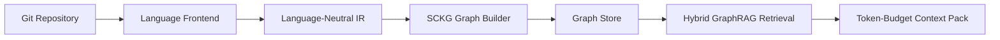

# Semantic Code Knowledge Graph (SCKG)

SCKG Phase 1 is a code-only semantic repository graph MVP. It converts a Python
repository into language-neutral intermediate representation (LNIR), persists it in a
replaceable graph store, and retrieves graph-grounded context for coding tasks.



## Phase 1 Scope

Implemented now: LNIR, deterministic IDs, Python extraction, graph store interface,
Neo4j and JSON stores, traversal APIs, CLI, hybrid retrieval, context packing, and a
small evaluation harness. Runtime telemetry, deployment lineage, API contracts,
temporal Git history, autonomous repair, and learned graph models are intentionally
out of scope.

## Install

```bash
python -m pip install -e ".[dev,embeddings]"
```

## Neo4j

```bash
docker compose up -d
set SCKG_STORE=neo4j
set NEO4J_URI=bolt://localhost:7687
set NEO4J_USER=neo4j
set NEO4J_PASSWORD=sckg-password
```

Without `SCKG_STORE=neo4j`, the CLI uses a local JSON graph at `.sckg/graph.json`.

## CLI

```bash
sckg index ./repo
sckg stats ./repo
sckg find-symbol AuthenticationMiddleware
sckg callers AuthenticationMiddleware.validate
sckg retrieve "Refresh tokens are incorrectly rejected by authentication middleware"
sckg retrieve "Trace why authentication refresh tokens are rejected" --strategy egpot --explain
sckg visualize --output .sckg/graph.html
sckg visualize --symbol AuthenticationMiddleware.validate --depth 2
```

## LNIR

Language frontends output `RepositoryNode`, `FileNode`, `Symbol`, and `Relation`
objects. Core graph and retrieval code never parse Python directly. Python-specific
syntax and semantic resolution live under `src/sckg/frontends/python`.

Symbol IDs are deterministic hashes over repository identity, normalized path,
language, qualified name, kind, and signature. `commit_id` is stored separately so a
future temporal graph can model evolution without changing symbol identity rules.

Every non-trivial relation carries `provenance` and `confidence`. Resolved semantic
edges use high confidence; unresolved or approximate relationships are either omitted
or explicitly marked heuristic.

## Graph Schema

SCKG v0 has `Repository`, `File`, and `Symbol` nodes. Typed relations include
`CONTAINS`, `DEFINES`, `REFERENCES`, `CALLS`, `IMPORTS`, `INHERITS`, `IMPLEMENTS`,
`OVERRIDES`, and `HAS_TYPE`. Neo4j constraints/indexes are created by the backend,
but the graph store interface remains storage-neutral.

## Retrieval

The retrieval pipeline performs lexical scoring, semantic scoring through a swappable
embedding interface, seed ranking, typed depth-limited graph expansion, interpretable
ranking, deduplication, and token-budget context packing. It returns structured
repository context rather than raw graph database output.

`--strategy egpot` adds an entropy-guided Pareto traversal layer after the existing
seed localization step. It records semantic, hop, contract, and information-gain
objectives for explored graph paths, applies non-dominated sorting plus crowding
selection, then sends only the selected path-preserving subgraph to the existing
context packer.

## Visualization

`sckg visualize` writes a standalone HTML file with an interactive semantic graph.
The view supports search, relation filtering, node/edge inspection, panning, zooming,
and label toggling. With the JSON backend it can render the stored graph directly.
For large graphs, use `--symbol <qualified-name> --depth 1` or `--limit` to keep the
visualization readable.

## Evaluation

The evaluation package supports graph-construction metrics, localization metrics,
retrieval metrics, and baseline routing for lexical, vector, hybrid, neighborhood,
and SCKG typed retrieval. Fixture repositories under `tests/fixtures` provide
gold symbols and edges for reproducible tests.

## Current Limitations

Python extraction currently uses the standard library AST as the always-available
parser, with tree-sitter dependencies declared for the parser adapter path. Call and
reference resolution is conservative; dynamic calls are not converted into precise
semantic edges unless they can be resolved.

## Future Frontends

JavaScript, TypeScript, C, C++, Java, and Go frontends should implement the same
`LanguageFrontend` protocol and emit LNIR.

## EG-POT Week 1 search engine

For a detailed explanation of the changes, their reasoning, graph hopping, and verification, see [EG-POT Week 1 Update](EGPOT_WEEK1_UPDATE.md).

Install trained embeddings with `python -m pip install -e ".[dev,embeddings]"`.
The default provider is `sentence-transformers/all-MiniLM-L6-v2`, a lightweight
text embedding model that also accepts source snippets. Inference runs locally on
CPU; the first use downloads model weights unless they are already cached. Change
`egpot.embedding_model` to a local sentence-transformers-compatible code model.
Set `embedding_local_files_only: true` for cached/local weights only. Model-loading
failures explain how to select hashing; providers never silently change mid-query.

```bash
sckg retrieve "Trace why authentication refresh tokens are rejected" --repo examples/auth_service_repo --strategy egpot --config configs/egpot.yaml --explain --trace .sckg/new-trace.json
# Fully offline, without model dependencies:
sckg retrieve "refresh tokens rejected" --strategy egpot --use-hash-sim
# Ablate search and hub suppression independently:
sckg retrieve "refresh tokens rejected" --strategy egpot --use-hash-sim --no-mcts --no-suppress-hubs
```

`--config` loads YAML explicitly; CLI overrides take precedence. Without it the
same search defaults are supplied by `EGPOTConfig`. Available overrides include
`--simulation-budget`, `--ucb-c`, `--max-hops`, `--beam-width`,
`--hub-degree-threshold`, and `--embedding-provider`. The `--use-hash-sim` flag
selects stable BLAKE2 token hashing for both localization and traversal. Hash
vectors are reproducible across processes (unlike the previous Python `hash`).

MCTS is enabled by default. Each query performs at most `simulation_budget`
simulations, each bounded by `max_hops`, cycle checks, and estimated token budget.
At each tree expansion, non-dominated sorting removes dominated candidates; the
first front is capped by beam width using crowding distance. PUCT selects tree
branches, greedy rollouts explore unseen branches, and terminal scalarized rewards
are backpropagated through every ancestor. `objective_weights` controls semantic,
hop, contract, and information-gain weights, in that order. The returned beam
contains the highest-valued sampled terminal paths. Pruning and finite simulation
budgets can miss the global optimum; this implementation makes no paper benchmark
or latency claims. `--no-mcts` retains the earlier per-hop Pareto beam algorithm.

Hub suppression counts distinct incoming neighbours, excluding self loops. Nodes
with in-degree **greater than** `hub_degree_threshold` (default 10) are excluded
from seeds and expansion in both hybrid and EG-POT retrieval. The structural
entropy estimator additionally discounts a hub's entropy by `threshold / degree`.
`--no-suppress-hubs` disables both behaviours. Selected path unions are also
bounded by the search's whitespace token estimate; the existing context packer
still controls the final rendered context budget.

`--explain` reports the provider, search mode, simulations, and paths. JSON traces
include PUCT priors, visit counts, and mean backpropagated values for the search
tree. The original `.sckg/egpot-trace.json` remains unchanged.

Validation:

```bash
python -m pytest -q
# Opt in to the actual cached-model similarity test (PowerShell):
$env:SCKG_TEST_REAL_EMBEDDINGS="1"
python -m pytest -q
# Compare both providers against the saved example trace; requires cached MiniLM:
python scripts/verify_egpot_week1.py
```

The validation script writes `.sckg/week1-validation/comparison.json` and a trace
for each provider. Tests cover a known target trajectory, reward backpropagation,
configurable weights, Pareto pruning, repeatability, cycles, hop/token limits,
CLI/YAML overrides, a 50-in-degree logger, and the embedding provider contract.
Weeks 2-4 (baselines, benchmark corpora, experiments, and the LLM harness) are
outside this implementation.

## Verify the update visually

From the repository root in PowerShell (no editable install needed):

```powershell
$env:PYTHONPATH = "src"
python scripts/verify_egpot_week1.py
python -m http.server 8765 --bind 127.0.0.1
```

Open `http://127.0.0.1:8765/.sckg/week1-validation/graph.html` for the auth-service
comparison. Select a **Recorded run** to compare local trained embeddings, hashing,
and the original saved baseline. Check the search mode and simulation count, choose
a **Selected trajectory**, then drag **Replay hops**. Expand **MCTS visits and
values** to inspect the actual search-tree statistics. The original trace lacks
ordered paths and MCTS statistics; the viewer labels these as unavailable.

Open `http://127.0.0.1:8765/.sckg/week1-validation/hub-suppression.html` for the
synthetic 50-caller logger fixture. The current run has suppression ON and selects
`caller0 -> useful`. Switch to **Suppression OFF** to see `caller0 -> logger`.
Click **All** to display the excluded hub and its callers; click `logger` to inspect
its in-degree. Amber dashed outlines mark hubs. This controlled fixture uses hashing
with semantic scoring disabled to isolate the effect of hub suppression.

These standalone HTML files also open directly in a browser. Their controls replay
recorded results; rerun the script after changing Python/configuration to regenerate
the evidence. It requires the MiniLM model cached by the embeddings setup above.

For your own query, generate a trace and pass it to the viewer:

```powershell
$env:PYTHONPATH = "src"
$env:SCKG_JSON_STORE = ".sckg/auth-service-graph.json"
python -m sckg.cli.main retrieve "Trace why authentication refresh tokens are rejected" --repo examples/auth_service_repo --strategy egpot --use-hash-sim --explain --trace .sckg/my-trace.json
python -m sckg.cli.main visualize --egpot-trace .sckg/my-trace.json --compare-trace .sckg/egpot-trace.json --output .sckg/my-graph.html
```

Repeat `--compare-trace` to include additional runs. Use traces from the same indexed
graph for meaningful comparisons. Hub in-degree in the viewer is calculated from
the displayed graph; a filtered or truncated graph can show fewer incoming neighbours
than the full graph used by retrieval. The recorded excluded-hub list remains authoritative.
