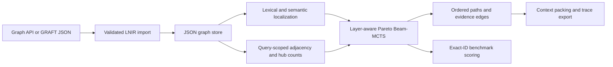

# Traversal architecture and benchmark contract

The deployed GRAFT viewer serves a graph snapshot through `/api/graph`.
`sckg import-graph` loads that snapshot directly, preserving exact node IDs,
parallel evidence, layers, locations, and original properties. Unknown relation
names, duplicate IDs, dangling endpoints, and invalid confidence values fail
explicitly. Absent confidence is marked heuristic (0.6); it is not promoted to
verified static evidence. Floating-point roundoff within 1e-12 is clamped.



Traversal can run in both directions (default), incoming only, or outgoing only.
Reverse traversal retains the original edge direction in its evidence; this
supports consumer -> contract <- implementation without inventing an edge.
`CONTAINS` and `DEFINES` are enabled alongside dependency, flow, semantic,
contract, and lineage relations. An empty edge allowlist permits no hops.

Each query builds adjacency in O(E), then expands incident edges in O(degree).
The snapshot is rebuilt between queries to reflect store mutations. Parallel
edges remain in storage; traversal collapses identical neighbor/relation actions
and entropy collapses identical outgoing neighbor/relation evidence. Cycles,
hop limits, token estimates, and optional node admission budgets bound search.
Node admission counts distinct nodes including seeds. Neighbor scoring is not
node admission. Candidate admission uses objective quality rather than relation
name order. This is not a bound on embedding evaluations or database reads.

The objectives remain semantic relevance, negative hop cost, contract
consistency, and entropy times novelty. Raw Shannon entropy is retained in
diagnostics; information gain is divided by log2(number of supported relation
types) to put it on a comparable scale to semantic and contract scores.

Pure local Pareto pruning can remove a low-similarity bridge before its target
is visible. This implementation reserves a Pareto representative from each
explicit edge layer before filling the remaining beam slots. If layers exceed
beam width, scalar value determines which representatives fit. The search
keeps sampled intermediate paths as valid stopping points, so it can return a
useful implementation without continuing into unrelated code. This is a
layer-aware EG-POT variant, not a proof of globally Pareto-optimal retrieval.
The no-Pareto weighted-sum ablation also removes these layer reservations.
MCTS still uses configurable scalar rewards for selection/backpropagation.

## Reproduce evaluation

Install `python -m pip install -e ".[dev,benchmark,embeddings]"`.
Set `$env:PYTHONPATH='src'` in PowerShell when running without an editable install.

```powershell
# Download the viewer's /api/graph JSON into tmp/deployed-graph.json first.
python scripts/verify_deployed_graph.py

# Exact IDs and reviewed labels are versioned in this repository.
python scripts/run_graph_benchmarks.py --graph .reference-sckg-build/online_boutique_graph.json --queries benchmarks/online-boutique.json --output output/benchmarks/boutique-hashing
python scripts/run_graph_benchmarks.py --graph .reference-sckg-build/online_boutique_graph.json --queries benchmarks/online-boutique.json --provider sentence-transformers --output output/benchmarks/boutique-minilm
```

The harness evaluates 10 baselines, EG-POT, and five ablations across budgets
20/40/60/100/200 and seeds 0-4. Expanded-budget uses twice the listed admission
budget and records the effective value. Vector retrieval ranks globally;
vector+BFS uses the common supplied start, vector-ranked neighbors, and hop
limits 2-5. Community retrieval uses NetworkX Louvain, not connected components.
Standard MCTS uses UCT with randomized exploration and no Pareto pruning.

Every graph method starts from the same exact consumer function. Gold targets
and gold paths are passed only to the scorer. Ranking of each method's returned
nodes uses the same semantic score. Exact IDs determine Hits@1/5, MRR@5, target
hit, expected-path node coverage, and ordered-path inclusion. Global vector,
PPR, and community methods return node sets and make no ordered-path claim.
Redundancy measures selected nodes outside the expected three-node contract
path; useful context outside that path can therefore count as redundant.

The 30 query rows cover 15 links and 10 implementation handlers. Paired explicit
and indirect questions share a link-level dev/test split (10 dev, 20 test rows).
There is no automatic parameter tuning. Some producer contract edges are
missing in the exported Online Boutique graph; expected paths record those
gaps rather than adding edges. The downloaded current source supplies review
evidence, but the existing export and source snapshot can have different line
locations. Graph/query hashes and the source commit are recorded.

Five EG-POT runs are deterministic repetitions, not independent random samples.
Wilcoxon tests average repetitions per query and use Holm correction across all
method/budget comparisons. Explicit and indirect queries from the same link
remain correlated, so these statistics are exploratory, not publication-grade
independent-sample evidence. Embedding matrix and Louvain preprocessing are
excluded from latency; per-query score initialization is included on first use.
No downstream LLM generation or Tree-of-Thoughts baseline is implemented.

The linked polyglot-repo-list is a catalog of eight systems, not an executable
test suite or a shared gold dataset. Running this Online Boutique matrix does
not establish benchmark accuracy on the other seven systems. The deployed
graph receives structural and end-to-end compatibility checks because its API
provides no semantic relevance gold labels or code snippets.
